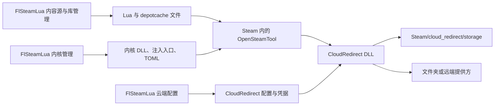

# FlSteamLua 功能有效性与核心契约审查

> 本文的 F1–F10 与 C1–C6 是修改前的审查证据，不代表修复后的当前状态。后续实现及验证记录见 `ARCHITECTURE.md`、`VALIDATION.md`。Lua 多目录、正式 TOML、票据身份事务、请求码参数和云存档管理已进入后续实现。
检查日期：2026-11-05。客户端基线：`456cf73b619a435aba64645dd61e3e6b72af8c43`，检查开始时工作区干净。本次检查源码、上游发布与隔离夹具；没有启动 Steam、加载内核、修改真实注册表或访问用户云端存档。

结论：客户端的功能分层大体有依据，大部分入口对应真实的文件、网络或原生接口操作。但“操作成功”与“核心生效”之间存在确定的断点，尚不能把功能清单中的“已实现”理解为可直接使用。首要问题是 Lua 加载目录、CloudRedirect 数据目录和配置文件、清单监听请求参数；其次是票据身份一致性、运行状态表达与配置生效范围。没有必要整体推翻页面或继续堆加开关，应先修通这些交界。

## 后续实施状态（2026-11-05）

以下审查正文保留检查时的基线。后续已完成 Lua 多目录与默认写入接线、正式 TOML 写入、云缓存目录与状态区分、插件安装/启停分离、清单统一取码与脚本请求上下文、渠道模板落盘及相关命名调整。

票据身份处理按用户后续明确的策略实施，替代 F5 中直接整组更新的建议：默认只替换 AppTicket/ETicket，保留缓存 SteamID；只有一次确认侧栏中的显式开关才同步票据身份。当前登录账号与票据不同不阻止导入。应用前 DPAPI 加密保存三项旧凭据及不存在状态，并备份、清理目标 Lua 的旧票据语句；提供整组恢复及失败回滚。

Lua 目录页固定目录置顶，自定义目录在下方；排序改为独立侧栏，取消不改动、保存应用顺序。无自定义目录时使用核心固定目录。

### 后续实机只读核查：分支重置与游玩时长

用户报告 Subnautica 2（AppID `1962700`）选择 `experimental` 后重启 Steam
回到默认版本并重复下载。2026-11-05 当晚读取本机配置和已有日志，未启动/退出
Steam、切换游戏分支或修改游戏文件：

- 核心两个已配置 Lua 目录中，该 depot `1962701` 唯一的 `setManifestid` 是
  注释语句 `--setManifestid(1962701,"6441437188629878150",0)`，当前没有启用该
  清单固定。客户端入库默认也会注释清单固定调用。
- `content_log.txt` 的 22:34:56 记录 `beta changed: experimental`，22:35:51
  下载 `6441437188629878150`；22:39:25 新的 Steam 会话启动后，22:39:40
  出现 `failed to update ownership ticket (Access Denied)` 和
  `0 active: 0 target:`，随后重新配置 depot，22:39:50 改为下载
  `6518956641559190686`。读取时 ACF 的 UserConfig/MountedConfig 仅有 language，
  没有 BetaKey。
- 本次固定提交的核心 `Hooks_Manifest.cpp` 只在存在 Lua override 时替换 depot
  清单，按 depot ID 匹配且不区分分支；没有直接清空 BetaKey 的代码。客户端
  常规扫描/启动也不写游戏分支。现有证据支持进一步检查核心许可初始化与 Steam
  分支状态的时序，尚不足以认定某一处 hook 是根因。授权失败日志本身不构成因果
  证明，需一次受控的核心日志/ACF 对照才能进一步定位；未做该实机重启验证。

同一游戏在 Steam `localconfig.vdf` 的 Playtime 为 `1247` 分钟，CloudRedirect
本地 stats 的 `minutes_forever` 也是 `1247`，与 Steam UI 的 `20.8` 小时一致。
客户端此前只读自己的 `library.json` 计时，缺少记录便显示 0。按用户要求，现已
移除客户端自行计时和最近游玩写入，只读取对应 Steam 账号的 Playtime/LastPlayed；
缺失显示未记录，不与旧本地计数累加。只读调用修正后的真实 LibraryService 已
得到 `1247` 分钟，并确认没有创建客户端游玩记录。

## 1. 本次使用的上游版本

| 对象 | 检查提交 | 最新发布核对 | 用途 |
| --- | --- | --- | --- |
| FlSteamLua | `456cf73b619a435aba64645dd61e3e6b72af8c43` | 本地 `master` | 当前客户端实现 |
| huanyuejue/OpenSteamTool | `fd95f56a840392185f8f973b9f504bdf94aaf66e` | `1.5.4.1`，tag 指向同一提交 | 当前核心契约 |
| OpenSteam001/OpenSteamTool | `2a08b0bfdc96c9e3f75df20f3f37bc8d8c09ee3a` | `1.4.8`，tag 为 `fb08dcef1de89b01ea3486b94fe698426d8745c2` | 停更代码线对照；不混同 HEAD 与发行包 |
| huanyuejue/CloudRedirect | `f5d122ddf18fbf5d0bacb8e914c665e965b15940` | `v2.6.7`，tag 指向同一提交 | 云存档配置、数据布局和运行机制 |

通过 Git 远端 HEAD/tag 与 GitHub 发布页交叉核对。GitHub API 限流后使用固定提交源码归档；随后通过用户提供的本地代理再次核对远端。发布资产确认：支线提供 Debug/Release ZIP；CloudRedirect 提供 `cloud_redirect.dll` 和 `.sha256`，与客户端下载地址的文件名一致。[支线发布](https://github.com/huanyuejue/OpenSteamTool/releases/tag/1.5.4.1)、[主线发布](https://github.com/OpenSteam001/OpenSteamTool/releases/tag/1.4.8)、[CloudRedirect 发布](https://github.com/huanyuejue/CloudRedirect/releases/tag/v2.6.7)。

本地旧对照为 OpenSteamTool `522b768`，本次重新取得了 `fd95f56`。两者差异涉及家庭共享/许可包处理及说明，不能继续照搬旧主线“绕过家庭共享限制”的宣传。当前支线明确保留 Steam 共享名额规则。[支线说明](https://github.com/huanyuejue/OpenSteamTool/blob/fd95f56a840392185f8f973b9f504bdf94aaf66e/README.md#L56-L60)

## 2. 核心与客户端的合理职责

OpenSteamTool 实际加载 Lua、处理清单请求与票据、承载 CloudRedirect；客户端负责准备文件和配置。CloudRedirect 在 Steam 内处理云存档 RPC，客户端的 Dart 上传/下载属于另外一条管理路径。设置凭据成功、写文件成功、核心加载成功、游戏同步成功，是不同的结果。[核心初始化](https://github.com/huanyuejue/OpenSteamTool/blob/fd95f56a840392185f8f973b9f504bdf94aaf66e/src/dllmain.cpp#L253-L305)、[插件宿主](https://github.com/huanyuejue/OpenSteamTool/blob/fd95f56a840392185f8f973b9f504bdf94aaf66e/src/Utils/CloudRedirect/CloudRedirectHost.cpp#L88-L164)、[云存档 API](https://github.com/huanyuejue/CloudRedirect/blob/f5d122ddf18fbf5d0bacb8e914c665e965b15940/src/platform/win/cr_api.cpp#L27-L58)

## 3. 必须优先修正的断点

### F1 · P1：Lua 入库目录与核心加载范围不一致

**触发条件：** 首次使用，未配置 `[lua].paths`，也没有手动把客户端 Lua 目录改成核心目录。

客户端 `_luaDirectories()` 默认返回 `Steam/config/stplug-in`。内容源提交、普通导入与局域网接收所使用的库路径都依赖这一套目录解析。OpenSteamTool 两条代码线的默认目录都是 `Steam/config/lua`。内核安装流程只安装受支持 DLL，没有把客户端默认目录补进核心 TOML。因此 Lua 可以写入成功、出现在客户端库里并标为启用，而 Steam 核心根本不读取它。

还存在同一问题的两个变体：设置了 `[lua].paths` 后，客户端把这些目录当成完整列表，漏掉核心始终追加的默认目录；在客户端设置自定义 Lua 目录时，只写客户端 settings，没有同步核心配置。客户端递归扫描目录，核心初始加载仅扫描每个加载目录的直接子文件，嵌套目录的“启用”也可能与核心不符。

**证据：** [客户端目录解析](/D:/MyCode/StudioProjects/FlSteamLua/lib/features/library/library_service.dart:1463)、[内容源写入目标](/D:/MyCode/StudioProjects/FlSteamLua/lib/features/content_sources/content_import_service.dart:80)、[自定义目录保存](/D:/MyCode/StudioProjects/FlSteamLua/lib/app/settings_page.dart:350)、[核心默认路径](https://github.com/huanyuejue/OpenSteamTool/blob/fd95f56a840392185f8f973b9f504bdf94aaf66e/src/dllmain.cpp#L168-L169)、[加载目录合并](https://github.com/huanyuejue/OpenSteamTool/blob/fd95f56a840392185f8f973b9f504bdf94aaf66e/src/dllmain.cpp#L286-L292)、[核心目录扫描](https://github.com/huanyuejue/OpenSteamTool/blob/fd95f56a840392185f8f973b9f504bdf94aaf66e/src/Utils/Config/LuaConfig.cpp#L734-L749)。隔离复核 C1、C2 已重现。

**处理方向：** 统一核心加载目录与客户端写入/扫描目录。默认使用 `config/lua`，额外目录按核心的追加与优先级规则处理；自定义目录必须明确是仅供客户端浏览还是同时加入核心加载。成功反馈至少区分“Lua 已写入”与“核心已加载”。

### F2 · P1：远端提供方下的本地存档视图扫错目录

CloudRedirect 始终把本地工作存储初始化为 `Steam/cloud_redirect/storage`。`sync_path` 只有在 `provider=folder` 时才作为文件夹提供方的目标。选择 WebDAV、S3、R2、Google Drive 或 OneDrive 后，插件不会把该路径当成自己的本地工作存储。

客户端 `refresh()` 却无论提供方是什么，都仅扫描 `syncPath`。因此插件已经缓存的游戏存档可能不会出现在本地列表；修改“本地存档目录”只移动旧文件夹提供方的数据，对远端模式下的插件工作目录不生效。`previewDelete()` 实际知道 `cloud_redirect/storage`，说明列表、目录设置、备份三处使用的存档模型并不一致。

**证据：** [客户端刷新](/D:/MyCode/StudioProjects/FlSteamLua/lib/features/cloud/cloud_service.dart:110)、[目录设置](/D:/MyCode/StudioProjects/FlSteamLua/lib/features/cloud/cloud_service.dart:181)、[备份目标枚举](/D:/MyCode/StudioProjects/FlSteamLua/lib/features/cloud/cloud_service.dart:540)、[核心工作目录与 provider 初始化](https://github.com/huanyuejue/CloudRedirect/blob/f5d122ddf18fbf5d0bacb8e914c665e965b15940/src/platform/win/cloud_intercept.cpp#L4872-L4977)。隔离复核 C3 已重现。

**处理方向：** 分清“插件本地缓存”“文件夹提供方仓库”“远端仓库”和“游戏原始存档”。远端模式应展示实际缓存；`sync_path` 应命名为文件夹提供方目录，并只在该模式下提供相应迁移。

### F3 · P1：只有示例 TOML 时，插件启用写入核心不会读取的文件

`_readKernelConfig()` 在主配置不存在、示例配置存在时选择 `opensteamtool.example.toml`，随后 `_setKernelEnabled()` 直接改写这个文件。客户端再读取同一个示例，显示已启用；OpenSteamTool 只读取 `opensteamtool.toml`，缺失时使用 `cloud.enabled=false` 的默认值。此时重启 Steam 也不会加载插件。

**证据：** [客户端配置文件选择与写入](/D:/MyCode/StudioProjects/FlSteamLua/lib/features/cloud/cloud_service.dart:444)、[核心配置文件名](https://github.com/huanyuejue/OpenSteamTool/blob/fd95f56a840392185f8f973b9f504bdf94aaf66e/src/dllmain.cpp#L168-L169)、[核心缺失配置处理](https://github.com/huanyuejue/OpenSteamTool/blob/fd95f56a840392185f8f973b9f504bdf94aaf66e/src/Utils/Config/Config.cpp#L111-L119)、[插件启用条件](https://github.com/huanyuejue/OpenSteamTool/blob/fd95f56a840392185f8f973b9f504bdf94aaf66e/src/Utils/CloudRedirect/CloudRedirectHost.cpp#L88-L106)。C4 重现了 `status.enabled=true` 但正式 TOML 不存在。

**处理方向：** 示例只能作为创建正式配置的输入，不能作为生效配置的写入目标；应从正式配置读取启用状态。

### F4 · P1：清单监听的三个备用接口请求参数错误，且不使用清单设置

`ManifestCdnDownloader` 的前两个接口使用 DepotID+GID，后三个 ManifestDeX、Wudrm、SteamRun 却把 DepotID 放入只接受 GID 的位置。前两个服务不可用时，这三个备用路径不能正确取得目标 manifest 的请求码。

该下载器由 `ToolsController` 单独创建，不使用内核服务的服务器选择、自定义地址或本地代理设置。因此用户在“清单配置”中切换服务器，不会改变“清单监听与修复”的行为。

**证据：** [监听下载器接口表](/D:/MyCode/StudioProjects/FlSteamLua/lib/features/tools/manifest_monitor.dart:182)、[独立创建下载器](/D:/MyCode/StudioProjects/FlSteamLua/lib/features/tools/tools_page.dart:27)、[内核接口表](https://github.com/huanyuejue/OpenSteamTool/blob/fd95f56a840392185f8f973b9f504bdf94aaf66e/src/Utils/SteamMetadata/ManifestClient.cpp#L59-L67)。C5 的请求记录确认三个地址均发送了 `441`，而目标 GID 是 `9876543210987654321`。

**处理方向：** 统一请求码获取入口，监听仅负责发现请求与下载 manifest 文件。当前它不会识别所有下载故障、重新触发游戏下载或重启 Steam，“清单请求监听/补充”比“修复”准确。

### F5 · P1：票据替换没有处理核心优先使用的缓存 SteamID

客户端能从 AppTicket 读出 SteamID，却只读写 `AppTicket` 与 `ETicket` 两个注册表值。核心 `GetSpoofSteamID()` 优先读取独立缓存的 `SteamID`，只有该值缺失才从 AppTicket 取身份。若之前缓存了账号 A 的 SteamID，再导入账号 B 的票据，客户端两项读回校验都能通过，核心仍可能选用 A 的身份。

**证据：** [票据解析](/D:/MyCode/StudioProjects/FlSteamLua/lib/features/patching/ticket_authorization.dart:107)、[注册表读取范围](/D:/MyCode/StudioProjects/FlSteamLua/lib/features/patching/ticket_authorization.dart:134)、[应用票据](/D:/MyCode/StudioProjects/FlSteamLua/lib/features/patching/ticket_authorization.dart:237)、[核心身份优先级](https://github.com/huanyuejue/OpenSteamTool/blob/fd95f56a840392185f8f973b9f504bdf94aaf66e/src/Utils/Tickets/AppTicket.cpp#L467-L488)。这是源码确认的条件性身份不一致，本次未进行真实账号授权复现。

**处理方向：** 按核心实际消费的整组凭据处理替换、备份与回滚。页面的“应用成功”应限定为凭据写入和一致性校验，不能表示已完成游戏的 Denuvo 握手或取得长期授权。入口仍有保留价值。

## 4. 有真实动作，但当前表达或安排不够准确

### F6 · P2：主页“已启用”不能代表内核或云插件正在工作

内核 `enabled` 仅按主体 DLL 存在且没有 `.off` 判断，不要求注入入口存在；主页直接使用它。内核管理页另行检查入口，会显示“缺少入口”，两个页面的结论不一致。云主页使用 `remoteSyncConfigured || enabled`：只有云端凭据、甚至没有启用插件，也可以显示绿色“已启用”。云存档页还把 `enabled=false` 的插件标为“未安装”，混淆安装与停用。

**证据：** [内核安装状态](/D:/MyCode/StudioProjects/FlSteamLua/lib/features/kernel/kernel_service.dart:2085)、[内核主页](/D:/MyCode/StudioProjects/FlSteamLua/lib/app/dashboard_page.dart:817)、[内核详情的正确细分](/D:/MyCode/StudioProjects/FlSteamLua/lib/features/kernel/kernel_settings_page.dart:402)、[云主页](/D:/MyCode/StudioProjects/FlSteamLua/lib/app/dashboard_page.dart:1136)、[云插件行](/D:/MyCode/StudioProjects/FlSteamLua/lib/features/cloud/cloud_page.dart:231)。C6 重现了无注入入口而 `enabled=true`。

建议至少区分“已安装、配置启用、入口异常、等待重启、运行未核验”。没有读取到运行证据时，使用“配置已启用”，不制造同步成功或核心健康状态。

### F7 · P2：云端切换、附带同步与插件启停混为一体

提供方配置保存后客户端立即切换显示，但插件是在初始化时创建 provider，没有对应的配置热切换路径；当前提供方保存流程只报告完成，没有安排重启或标注待生效。与此同时，`configureProvider()`、`setSyncPath()`、`enableRedirect()` 都强制写入 `sync_achievements=true` 和 `sync_playtime=true`。上游这两个开关默认关闭，并明确交由用户配置控制，`CR_EnableStatsSync()` 也不会替用户开启它们。普通存档设置因此附带改变成就和时长同步行为。

插件“启用”与“安装/更新”也共用 `enableRedirect()`：已有插件重新启用仍会联网下载最新 DLL，断网时无法单纯恢复本地插件的启用状态。插件页只展示路径、大小、时间，没有可比较的安装版本与目标版本。

**证据：** [提供方写入](/D:/MyCode/StudioProjects/FlSteamLua/lib/features/cloud/cloud_service.dart:237)、[安装和启用共用](/D:/MyCode/StudioProjects/FlSteamLua/lib/features/cloud/cloud_redirect_plugin_page.dart:88)、[下载与附带设置](/D:/MyCode/StudioProjects/FlSteamLua/lib/features/cloud/cloud_service.dart:378)、[提供方保存入口](/D:/MyCode/StudioProjects/FlSteamLua/lib/features/cloud/cloud_page.dart:529)、[上游同步默认值](https://github.com/huanyuejue/CloudRedirect/blob/f5d122ddf18fbf5d0bacb8e914c665e965b15940/src/common/metadata_sync.cpp#L8-L9)、[上游配置读取](https://github.com/huanyuejue/CloudRedirect/blob/f5d122ddf18fbf5d0bacb8e914c665e965b15940/src/platform/win/cloud_intercept.cpp#L4999-L5009)、[宿主 API 只注册能力](https://github.com/huanyuejue/CloudRedirect/blob/f5d122ddf18fbf5d0bacb8e914c665e965b15940/src/platform/win/cr_api.cpp#L201-L205)。

建议把安装/更新、配置启停、云端配置各自完成其动作；提供方变更显式标记需要重新启动 Steam；成就与时长同步保持已有用户选择，并放在独立的高级设置中。

### F8 · P2：云端文件复制不等于恢复游戏存档，删除范围也比当前行大

CloudRedirect 的远端数据包含 `account/app/blobs/filename/sha1`、`manifest.cloudredirect`、变更号与 token 元数据。客户端下载只是递归原样复制。这对导出原始仓库有用；如果期望得到能直接交给游戏的 `slot.sav`，实际得到的会是 `blobs/slot.sav/<sha1>`。直接复制一个完整文件夹提供方仓库可以保留这种格式，不能因此宣称普通存档上传或游戏恢复已经接通。[云端对象路径](https://github.com/huanyuejue/CloudRedirect/blob/f5d122ddf18fbf5d0bacb8e914c665e965b15940/src/common/cloud_storage.cpp#L352-L380)、[元数据路径](https://github.com/huanyuejue/CloudRedirect/blob/f5d122ddf18fbf5d0bacb8e914c665e965b15940/src/common/cloud_metadata_paths.h#L13-L48)、[客户端下载/上传](/D:/MyCode/StudioProjects/FlSteamLua/lib/features/cloud/cloud_service.dart:935)。原始仓库导出对照已通过，未观察到解包成游戏文件的步骤。

此外，点击一个账号的本地或远端行执行删除，实际只传 AppID，预览会收集这个游戏的所有账号、文件夹仓库、插件缓存、Steam userdata 与当前远端。确认框会列出这些路径，因此并非无提示删除，但操作粒度仍与行级入口不一致。恢复/删除也未像 DLL 安装那样阻止 Steam 继续写入，备份哈希校验不能代替与运行中同步引擎协调。[行级操作](/D:/MyCode/StudioProjects/FlSteamLua/lib/features/cloud/cloud_page.dart:489)、[实际删除范围](/D:/MyCode/StudioProjects/FlSteamLua/lib/features/cloud/cloud_service.dart:540)、[恢复入口](/D:/MyCode/StudioProjects/FlSteamLua/lib/features/cloud/cloud_page.dart:502)。

建议保留“原始仓库导出/备份”；若提供“恢复到本机游戏”或“立即同步”，应接入 CloudRedirect 的同步机制。上游已有 `sync-remote-app`/`sync-all-remote-apps` 及 `CloudRedirect_CliMain` 导出，可以评估由隔离 worker 调用，避免客户端另造一套存档协议。删除应明确针对一个账号和位置，另设全范围清理。[上游同步命令](https://github.com/huanyuejue/CloudRedirect/blob/f5d122ddf18fbf5d0bacb8e914c665e965b15940/src/common/cli.cpp#L649-L683)、[CLI 导出](https://github.com/huanyuejue/CloudRedirect/blob/f5d122ddf18fbf5d0bacb8e914c665e965b15940/src/common/cli.cpp#L1444-L1454)。

### F9 · P2：TOML 数据渠道只影响客户端手动获取，未改变核心自动渠道

`saveTomlChannelSettings()` 只保存 FlSteamLua 设置；`fetchTomlFiles()` 使用它下载缓存文件。这是有效的手动预取功能，但没有写入核心 `[remote].url_template`。Steam 更新后遇到新 SHA 时，核心仍使用自己的默认渠道。支线默认 `huanyuejue/steam-monitor/main/{channel}/{component}/{sha256}.toml`，主线使用以 `pattern`/`ipc` 为分支的布局，客户端却把“channel”另当作一个公共分支或目录字段，含义不一致。

**证据：** [保存渠道](/D:/MyCode/StudioProjects/FlSteamLua/lib/features/kernel/kernel_service.dart:1530)、[手动获取 URL 组成](/D:/MyCode/StudioProjects/FlSteamLua/lib/features/kernel/kernel_service.dart:1349)、[客户端默认配置](/D:/MyCode/StudioProjects/FlSteamLua/lib/features/kernel/kernel_models.dart:11)、[支线远端模板](https://github.com/huanyuejue/OpenSteamTool/blob/fd95f56a840392185f8f973b9f504bdf94aaf66e/src/Utils/SteamMetadata/RemoteToml.cpp#L15-L77)、[主线模板](https://github.com/OpenSteam001/OpenSteamTool/blob/2a08b0bfdc96c9e3f75df20f3f37bc8d8c09ee3a/src/Utils/SteamMetadata/RemoteToml.cpp#L16-L21)。

建议明确区分“手动下载来源”和“核心自动更新来源”。若页面宣称配置核心渠道，应生成核心真正读取的模板；已有缓存命中也应说明不会立即切换其内容。

### F10 · P2：自定义清单服务器、本地代理和核心自动回退的边界隐藏了

“自定义服务器”也会安装 Lua 桥并访问 `127.0.0.1:47831`，因此要求 FlSteamLua 保持运行，并非把 URL 交给核心独立使用。客户端退出后 Lua 返回 nil，核心会继续尝试 TOML 内置源，所以下载成功也不能证明自定义服务器生效。内置服务器模式没有展示上游支持的 failover 开关；保存时还会整段重写 `[manifest]`，移除用户原有 timeout 字段。

本地代理有代码入口，不能称为空按钮，但默认四个 JS 源均不声明请求码能力；并且源调用只收到 AppID 与能力列表，收到的 DepotID/GID 仅用于事后筛选返回结果，没有传给脚本。它适合返回一组请求码的脚本，不足以完整支持按 Steam 当前请求逐个取码的通用端点。

**证据：** [Lua 桥](/D:/MyCode/StudioProjects/FlSteamLua/lib/features/kernel/kernel_service.dart:45)、[保存配置和启动代理](/D:/MyCode/StudioProjects/FlSteamLua/lib/features/kernel/kernel_service.dart:1540)、[源适配器](/D:/MyCode/StudioProjects/FlSteamLua/lib/app/app_services.dart:52)、[JS 请求参数](/D:/MyCode/StudioProjects/FlSteamLua/lib/features/manifests/manifest_source_service.dart:254)、[上游 Lua 失败后的行为](https://github.com/huanyuejue/OpenSteamTool/blob/fd95f56a840392185f8f973b9f504bdf94aaf66e/src/Utils/SteamMetadata/ManifestClient.cpp#L279-L314)。

建议将“清单文件、固定版本 ID、下载请求码”三个概念明确区分；代理设置显示运行依赖与实际命中来源，并完整传递请求上下文。现有本地代理宜放在高级选项。

## 5. 功能安排建议

| 功能 | 判断 | 建议安排及成功边界 |
| --- | --- | --- |
| Lua 库、Steam 已安装库 | 两类数据分开合理；目录契约有阻断 | 保留双 Tab；先修 F1。安装记录与 Lua 均不能代替账号所有权 |
| 商店与统一内容源入库 | 解析、预览、备份和提交存在真实实现 | 保留；反馈“配置已写入”，游戏下载交由 Steam，不能把添加到库等同于已下载 |
| DLC 分析、手工 DLC、版本固定 | 真正读取元数据并追加 Lua，不是空控件 | 普通用户只保留 DLC 管理入口；手工 AppID、版本 pins 收入游戏高级工具。文件更新后仍须处于核心加载范围 |
| 内核安装、更新、入口切换、快照恢复 | 有实际包校验、文件切换和回滚价值 | 保留在“内核与插件”；区分安装状态、入口状态、运行证据 |
| TOML 在线获取 | 可以写入核心缓存，有实际用途 | 作为兼容性维护；修清渠道含义和生效范围，见 F9 |
| 本地临时 TOML 构建 | 有 PE 扫描与 TOML 生成，不是模拟日志 | 定位为受限高级工具；使用内嵌精确字节与固定 IPC 描述，并非通用的未知 Steam 版本适配器，不宜作为常规一键修复。[实现](/D:/MyCode/StudioProjects/FlSteamLua/lib/features/kernel/local_toml_builder.dart:179) |
| 清单监听 | 有日志解析、排队和 CDN 下载 | 与请求码设置共用数据入口；改为“监听并补充清单”，修 F4 |
| CloudRedirect 安装与凭据配置 | DLL 资产名、配置路径、DPAPI 凭据字段大体对上核心 | 保留，修 F2/F3/F7；凭据存在只代表已配置，不能代表插件运行或同步成功 |
| 云端浏览、原始数据备份/导出 | HTTP/文件操作是真实的 | 保留并准确命名；区分仓库对象和可直接使用的游戏存档，见 F8 |
| 成就编辑 | 有原生 worker、提交和读回确认 | 保留。该读回证明当前 Steam 接口可见状态，不自动证明官方服务器或自建云端同步完成。[实现](/D:/MyCode/StudioProjects/FlSteamLua/lib/features/achievements/achievement_service.dart:132) |
| D 加密票据导入、提取 | 是有效的底层工具，不是完整授权引擎 | 使用“票据管理/提取”作为具体动作，修 F5；真正的运行授权由核心和游戏完成 |
| 好友游玩广播 | 在当前支线有对应配置；不是全局 Steam 隐私开关 | 改为“Lua 游戏好友广播”，移到内核相关设置。主线没有对应 `[presence]` 配置读取；选用旧核心时不能继续暗示该开关有效。[支线配置](https://github.com/huanyuejue/OpenSteamTool/blob/fd95f56a840392185f8f973b9f504bdf94aaf66e/src/Utils/Config/Config.cpp#L192-L196)、[当前客户端入口](/D:/MyCode/StudioProjects/FlSteamLua/lib/features/preferences/preferences_page.dart:138) |
| OST 480 与 OnlineFix 资源 | 前者是操作指南，后者是资源浏览/下载，两者都有用途 | 明确分组。480 页目前只复制 `-onlinefix`，没有直接应用或验证联机，且未覆盖支线 `-realappid` 选项；不能称自动联机修复。[客户端](/D:/MyCode/StudioProjects/FlSteamLua/lib/features/tools/online/online_pages.dart:355)、[支线说明](https://github.com/huanyuejue/OpenSteamTool/blob/fd95f56a840392185f8f973b9f504bdf94aaf66e/README.md#L107-L111) |
| 文件校验、补丁下载、Goldberg | 是不同的工作流，当前拆开是合理的 | 保留游戏上下文入口；下载/覆盖文件成功不能直接代表游戏已可运行。Goldberg 与核心不应组合成默认必做步骤 |
| 修改器、局域网传输、数据管理 | 有独立服务与引擎，不是 OpenSteamTool 自身能力 | 作为客户端扩展保留在工具/管理入口；不能因上游没有这些接口而判无效。本次没有重新验收两机传输或修改器联动 |

OpenSteamTool 支线新增能力不需要全部变成独立页面。`forcedenuvo`、`setlegacycdkey`、`setStat`、可选游戏进程注入等可以保留在高级配置或已有 Lua 编辑流程中。当前更有价值的工作是暴露实际配置作用范围、加载错误和生效结果。

## 6. 哪些属于形式成功，哪些只是受限功能

- **可确定的形式成功：** Lua 写到核心不加载的目录；插件开关写到示例 TOML；主页用凭据或 DLL 文件存在代替可用状态。这些会让用户看到成功而对应核心行为未发生。
- **实现缺陷造成的条件失效：** 清单监听备用参数错误；缓存 SteamID 与新票据身份不一致；云端提供方下的本地视图扫错目录。
- **功能有效但名称过宽：** TOML 手动下载称为核心渠道设置；清单补充称修复；原始仓库复制被理解成恢复游戏存档；票据写入被理解成已授权。
- **有真实用途的受限工具：** 固定签名本地扫描、480 操作指南、需要自定义脚本的请求码代理。应明确适用条件，不能直接判作无效，也不宜作为普通用户的默认流程。

建议修复顺序：F1/F2/F3 → F4/F5 → F6/F7 → F8/F9/F10 与入口命名。普通用户的主流程应是“准备核心 → 获取并写入配置 → Steam 安装/启动 → 根据实际需求配置云存档”；票据、补丁、Goldberg、版本固定和联机辅助都应按游戏需要进入。

## 7. 本次验证与证据限制

临时契约复核直接调用当前客户端服务，所有文件均写入 `.git/references/audit-20261105/temp` 的隔离目录，HTTP 使用夹具，没有执行真实 DLL。

| 场景 | 结果 |
| --- | --- |
| C1：默认写入目录应与核心默认目录一致 | 不一致，实际为 `config/stplug-in` |
| C2：额外 Lua 目录应保留核心默认目录 | 不一致，只发现额外目录中的游戏 |
| C3：远端模式本地列表应包含插件工作缓存 | 不一致，有缓存但本地列表为空 |
| C4：启用插件应写入核心实际读取的 TOML | 不一致，显示已启用而正式 TOML 不存在 |
| C5：GID-only 清单 API 应收到目标 GID | 不一致，后三个备用 API 收到 DepotID |
| C6：无注入入口不应被主页判为已启用 | 状态模型不一致，`entryState=none` 但 `enabled=true` |
| 对照：显式设置匹配核心的 Lua 目录后导入扫描 | 通过 |
| 对照：导出完整 CAS 仓库保留原始字节和层级 | 通过；不产生平铺的游戏存档文件 |

脚本：[core_contract_audit_test.dart](/D:/MyCode/StudioProjects/FlSteamLua/.git/references/audit-20261105/core_contract_audit_test.dart)。日志：[contract-test.log](/D:/MyCode/StudioProjects/FlSteamLua/.git/references/audit-20261105/contract-test.log)。6 项预期契约断言失败用于暴露问题，另 2 项对照通过，不能表述为客户端测试整体通过。

验证工具自身有两项环境异常：`worktree.py` 因缺少 `scripts` 模块未完成；`bounded_run.py` 在启动 Flutter 后因 Windows 无 `signal.SIGHUP` 报错。Flutter 子进程仍完成了 8 项复核并输出 `+2 -6`，随后确认没有残留 `flutter_tester`。这些输出作为局部复现证据，不能当作正式门禁成功记录；本次未修改工具或反复重跑。

没有执行 UI 变更、全套测试或 Windows 发布构建。未验证真实 Steam 注入、当前登录账号票据握手、成就服务端写回、云端 OAuth/读写、游戏启动与跨机器同步。上述源码断点足以说明现有功能安排存在问题，但不能据此推定每台机器、每个配置都失败；已手动配置正确目录的用户可能绕过部分问题。

本次仅新增本报告与 Git 私有目录中的审查证据，未修改客户端业务代码、提交或推送。
